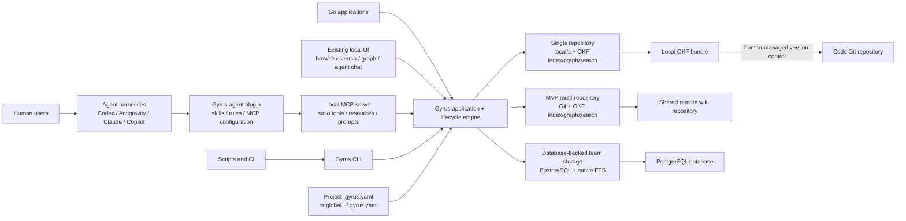
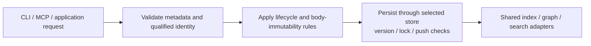
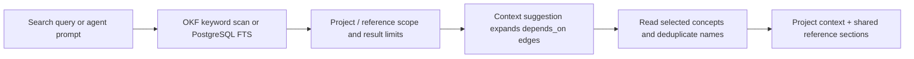
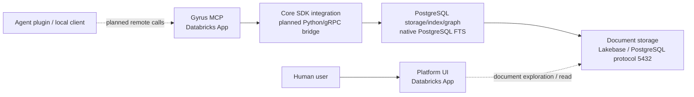
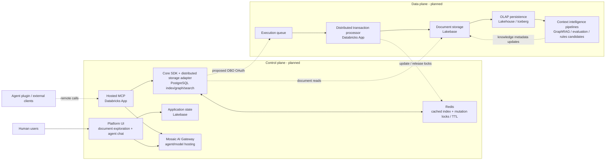

# System architecture and deployment blueprint

Gyrus is an Intelligence Platform whose current foundation manages structured engineering knowledge through one lifecycle engine. The [architecture drawing](../../../../drw_arch-gyrus.png) describes its progression from a local client to a shared Git collection, hosted team services, and an enterprise control/data plane. This guide retains that progression and the bundle topology while identifying which components exist today.

## 1. Client interfaces and current deployment paths

Humans work through agent harnesses such as Codex, Antigravity, Claude, and Copilot, or use the CLI/local UI directly. The Gyrus plugin distributes skills, rules, and MCP startup configuration. Scripts call the CLI; applications can integrate with the Go contracts and engine. Each local server resolves configuration and constructs one storage instance shared by its query adapters.



The local profile writes the code repository's filesystem; any commit/push of those files is handled outside that provider. The Git profile reads/writes a remote knowledge repository itself, allowing several code repositories to share reference knowledge and keep distinct project context. The PostgreSQL profile stores concepts, schema overrides, graph data, and FTS data in a shared database.

| Profile | Storage | Index | Graph | Search | Typical use |
| --- | --- | --- | --- | --- | --- |
| local | localfs | okf | okf | okf | One repository and its engineering knowledge |
| git | git | okf | okf | okf | Several repositories sharing a wiki and Git review workflow |
| postgres | postgres | postgres | postgres | postgres_fts | Shared database-backed team knowledge |

These are complete supported stacks. All use the same public concept/relationship model. Hosting a server and choosing PostgreSQL storage are separate concerns: the database stack exists; the hosted Databricks MCP/UI applications in the drawing are roadmap work.

The drawing includes local SQLite document-index caches. The current local and Git stacks scan authoritative OKF content directly and have no selectable persistent cache provider. Cache choices `none`, `sqlite`, and `redis` belong to the [roadmap](prd-001-specification-roadmap.md). Schema/query correctness must not depend on an unimplemented cache.

## 2. Runtime components and package responsibilities

| Component | Responsibility |
| --- | --- |
| `pkg/gyrus` | Public `Concept`, mutation/query/result types, and `ConceptStore`, `IndexStore`, `GraphStore`, `SearchProvider` contracts; optional scanners/schema stores |
| `internal/config` | File discovery, strict nested YAML, defaults, qualified project context, and complete-stack validation |
| `internal/app` | Generic dependency container; shares one concept store with the lifecycle engine and adapters |
| `internal/domain/okf` and `internal/format` | Parse/serialize concept payloads, validate metadata/identity/typed links, derive collection locations, and supply embedded templates |
| `internal/domain/lifecycle` | Orchestrate creation/updates, lifecycle/body-immutability rules, search, graph operations, schema resolution, and context assembly |
| `internal/provider` | Construct local/Git/PostgreSQL stores and the corresponding OKF/database adapters |
| `internal/persistence` | Filesystem safety/locking/atomic replacement and database infrastructure |
| `internal/cli`, `internal/mcp`, `internal/ui` | Public command, protocol, and local web interfaces |
| `packaging/plugins/gyrus` | Client plugin manifests, skills/rules, and MCP launch configuration |

Git session state stays in the Git store. CLI/MCP handlers access that provider through the application's generic store; runtime initiative names are not factory configuration or application-level Git fields. The server coordinates switching with whole requests so an operation cannot begin on one initiative and finish on another.

## 3. Knowledge write and retrieval flows



Local writes use cooperating-process locks and atomic file replacement. Git reloads confirmed remote state and pushes normal commits without force; rejected competing pushes become conflicts. PostgreSQL uses its existing transactions and expected-version checks. These protections are per concept; the current system provides no distributed queue or cross-concept two-phase commit.



Context suggestion prioritizes project matches, then linked dependencies, then remaining shared references, up to the concept-count limit. It uses explicit scope and relationships; it does not implement semantic search, authority arbitration, or enforced token truncation. General graph traversal is a separate cycle-safe operation.

### Git review workflow

`direct` reads and writes `trunk_branch` (default `main`). `branching` uses an initiative chosen through `--git-branch` or MCP `gyrus_git_switch`; all concepts, schema overrides, links, and queries follow the selection. A missing initiative initially reads trunk and is created remotely on its first mutation. Each MCP process owns its selection; restarting requires selecting again.

Humans open/review/merge PRs and integrate trunk changes through the Git host. Gyrus does not merge, rebase, or force-push. HTTPS uses the configured Git credential manager through noninteractive `git credential fill`; SSH uses an agent or standard keys and verifies known hosts. See the [initiative walkthrough](guide-006-git-initiatives.md).

## 4. OKF bundle topology and identity

A code repository using local storage normally contains:

```text
code-repository/
├── .gyrus.yaml
└── .gyrus/
    ├── concepts/
    │   └── <tenant>/
    │       ├── reference/
    │       │   ├── adr-storage.md
    │       │   ├── standards-engineering.md
    │       │   └── spec-contract.md
    │       └── projects/
    │           ├── payments/
    │           │   └── guide-deploy.md
    │           └── billing/
    │               └── prd-checkout.md
    └── schemas/
        ├── adr.md
        ├── guide.md
        └── specification.md
```

For Git storage the same `.gyrus/concepts` and `.gyrus/schemas` paths live inside the remote wiki repository. Each consuming code repository supplies its own `.gyrus.yaml` pointing to that remote and selecting its project. The remote need not contain each consumer's configuration. `storage.root` changes a local filesystem root; it does not relocate the Git collection.

- `root/reference/adr-storage` identifies a tenant-shared reference concept.
- `root/projects/payments/guide-deploy` identifies a project concept.
- Frontmatter stores local `id: guide-deploy`; location supplies the qualified name, scope, and project. Same local IDs in different projects/tenants remain distinct.
- Relationships persist only as `links: [{concept: <qualified-name>, rel: <type>}]`. Incoming queries provide backlinks. OKF can retain a qualified missing target; PostgreSQL graph endpoints must exist.
- Schemas are collection-wide overrides for the current store/branch. Persisted templates precede the binary's embedded templates; only an absent override permits fallback.

There is no `index.db` requirement in the current bundle and no `.gyrus/docs/.../workspaces` topology. PostgreSQL represents equivalent concepts, schemas, history, and edges in tables; it does not use a filesystem bundle as its persistence format.

Lifecycle behavior includes ADR `proposed → accepted/rejected` and `accepted → superseded/deprecated`; improvement proposals `draft → reviewing → approved → implemented` with rejection/abandonment paths; and general documents `draft → active → deprecated/archived`. Finalized protected bodies require replacement decisions when their content changes; metadata-only updates remain possible under the [contract rules](spec-001-contract-schema.md).

## 5. Configuration and process boundaries

Explicit `GYRUS_CONFIG` selects a file; `GYRUS_PROJECT` selects a project directory. Otherwise discovery searches upward for a project `.gyrus.yaml`, uses the existing container-project fallback where applicable, then global `~/.gyrus.yaml` and defaults. Project configuration fully replaces global configuration. Relative local roots resolve against the selected file's directory; present malformed/unknown configuration fails rather than falling through.

A local MCP server, CLI invocation, and UI process each have their own application container. Sharing a store within one process gives its adapters a consistent provider/session selection; sharing a remote/database coordinates the collection across processes through provider conflict checks. Tenant/project scope is a knowledge-selection model, not a substitute for host/database access control or a row-level authorization service.

## 6. Planned team platform from the drawing

The team stage hosts MCP and document exploration near a PostgreSQL-compatible Lakebase database. The Go contracts/engine remain the common knowledge behavior; the roadmap includes a Python MCP/gRPC integration. The drawing's port 5432 identifies the PostgreSQL protocol, not an already-deployed service.



The database provider is implemented; hosted apps, remote authentication, Python/gRPC integration, and their deployment are planned. The hosted UI's direct database read arrow mirrors the drawing and does not settle its final API/access-control contract. The drawing leaves transaction queues versus two-phase commit open; the roadmap tracks that decision before stronger team write guarantees are claimed.

## 7. Planned enterprise control and data planes

The enterprise stage separates interactive request handling from asynchronous storage execution and intelligence processing. This diagram follows the drawing's services and data paths; every node in this section is a target architecture component, not a current deployment claim.



The control plane would validate requests, serve indexed knowledge and chat, manage application state, and coordinate locks/cache. The data plane would execute queued writes, persist documents, feed analytical storage, and process intelligence outputs. Gateway/model choices and intelligence techniques remain candidates requiring evaluation.

Open decisions carried from the drawing:

- Whether a generic service API should sit behind MCP and also serve the UI.
- The transaction model: row/version protections, explicit two-phase commit, or queued execution and their failure/retry semantics.
- On-behalf-of OAuth identity propagation, authorization boundaries, and worker access.
- Lock ownership/TTL recovery, cache freshness, and read-after-write behavior across services.
- Which intelligence outputs may update knowledge directly and which require human review.

See the [roadmap](prd-001-specification-roadmap.md) for delivery work, the [architecture specification](spec-000-overview.md) for current contracts, and the [provider/configuration reference](tech-ref-002-config-schema.md) for runnable setups.
