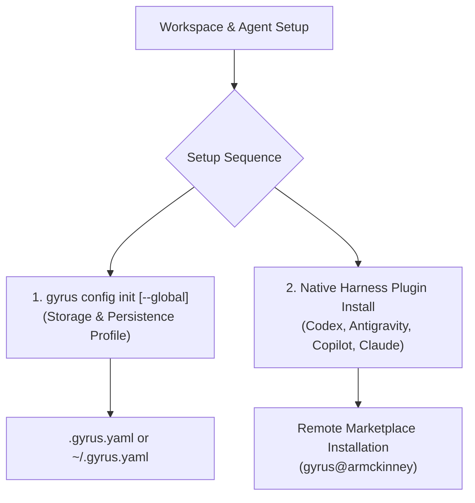

# Gyrus Installation & Initialization Guide

This guide walks you through installing the `gyrus` standalone binary, initializing your workspace configuration (`.gyrus.yaml`), and installing the Gyrus Agent Plugin into your AI coding assistant via native harness marketplaces.

---

## 📦 1. Installing the Gyrus Binary

### From Binary Release / Source Build

```bash
git clone https://github.com/armckinney/gyrus.git
cd gyrus
make build
```

Verify the installation:

```bash
./gyrus --help
```

Ensure the compiled `gyrus` executable is moved to your system `PATH` (e.g. `/usr/local/bin/gyrus`) so client harnesses can launch it for Model Context Protocol (MCP) interactions.

---

## 🚀 2. Two-Step Workspace Initialization

Gyrus cleanly decouples workspace repository configuration from client tool distribution:



---

## ⚙️ 3. Initializing Workspace & Global Configuration (`gyrus config init`)

Bootstraps repository or global configuration and sets up the local or cloud persistence profile:

```bash
# Initialize repository workspace configuration (.gyrus.yaml)
gyrus config init

# Or initialize user-wide global configuration (~/.gyrus.yaml)
gyrus config init --global
```

### Flag Options

| Flag | Shorthand | Description | Default |
| :--- | :--- | :--- | :--- |
| `--profile` | `-p` | Configuration profile (`local`, `git`, `blob`, `s3`, `azure`, `gcs`, `postgres`, `vector`). | `local` |
| `--owner-group` | `-o` | Default security owner group for documents. | `root` |
| `--global` | `-g` | Write user-wide configuration to `~/.gyrus.yaml`. | `false` |
| `--force` | `-f` | Overwrite existing configuration file without prompting. | `false` |

### Storage Profile Options (`--profile`)

```bash
gyrus config init --profile local     # LocalFS storage + OKF index/graph/search (default)
gyrus config init --profile git       # Remote Git Repository Persistence
gyrus config init --profile s3        # AWS S3 Bucket Storage
gyrus config init --profile azure     # Azure Blob Container Storage
gyrus config init --profile gcs       # Google Cloud Storage Bucket
gyrus config init --profile blob      # Cloud Blob Storage
gyrus config init --profile postgres  # PostgreSQL Database Backend
gyrus config init --profile vector    # Semantic Vector Search Profile
```

### Required Cloud Storage Permissions
When using cloud object storage (`s3`, `azure`, `gcs`), ensure your environment has appropriate data plane access:
- **AWS S3 (`s3`):** IAM policy must grant `s3:GetObject`, `s3:PutObject`, `s3:DeleteObject`, and `s3:ListBucket`.
- **Azure Blob (`azure`):** Azure identity must be assigned `Storage Blob Data Contributor` or `Storage Blob Data Owner`.
- **Google Cloud Storage (`gcs`):** Service account must be assigned `roles/storage.objectAdmin` or `roles/storage.objectUser`.

---

## 🤖 4. Installing Agent Plugin via Harness Marketplace

Install Gyrus directly into your AI coding assistant using native harness plugin commands:

### OpenAI Codex CLI

```bash
# Register the GitHub repository as a remote marketplace
codex plugin marketplace add armckinney/gyrus

# Install the gyrus plugin
codex plugin add gyrus@armckinney
```

### Google Antigravity (AGY)

```bash
# Install directly from repository plugin path
agy plugin install https://github.com/armckinney/gyrus/tree/main/packaging/plugins/gyrus
```

For workspace development inside the Gyrus repository, Antigravity automatically discovers local plugins via `.agents/plugins.json`.

### GitHub Copilot CLI

```bash
# Register marketplace and install plugin
copilot plugin marketplace add armckinney/gyrus
copilot plugin install gyrus@armckinney
```

### Anthropic Claude Code

```bash
# Register marketplace and install plugin
claude plugin marketplace add armckinney/gyrus
claude plugin install gyrus@armckinney
```

---

## 🎛️ 5. Configuring Automation & Lifecycle Hooks

Gyrus packages lifecycle hooks (`PreInvocation` and `Stop`) into the Agent Plugin bundle to automate context retrieval and encourage documentation compliance without nagging on routine code changes.

You can configure, enable, or disable this functionality at multiple levels:

### In Workspace Configuration (`.gyrus.yaml`)
To customize or disable hooks for your repository, add the `automation` block:

```yaml
automation:
  hooks_enabled: true         # Master switch (set to false to disable all hooks)
  auto_context: true          # Inject high-level context before agent reasoning
  architectural_check: true   # Prompt agent on stop if architectural contracts change
  ignored_paths:              # Files and directories ignored during checks
    - "tests/**"
    - "*_test.go"
    - "*.lock"
    - "vendor/**"
    - "node_modules/**"
```

### Temporary Shell Override (Environment Variable)
To temporarily disable all hook execution without modifying configuration:
```bash
export GYRUS_HOOKS_ENABLED=false
```

## Qualified concepts and minimal links

Creation retains a local id and returns its qualified name. Address existing concepts with tenant/reference/id or tenant/projects/project/id across SDK, CLI, MCP, and UI. API envelopes include name; YAML frontmatter does not persist it. Relationships use only links with concept and rel. Dependency arrays, old link keys, per-link creation metadata, and short lookup IDs are rejected. Local IDs may repeat across tenants/projects. Incoming neighbors provide backlinks; relationship types and general cycle-safe graph traversal remain unchanged. Use the migration skill for legacy concepts or SQLite graph exports; retain backups and rebuild obsolete identity databases explicitly. Restart cached MCP processes after upgrading.
