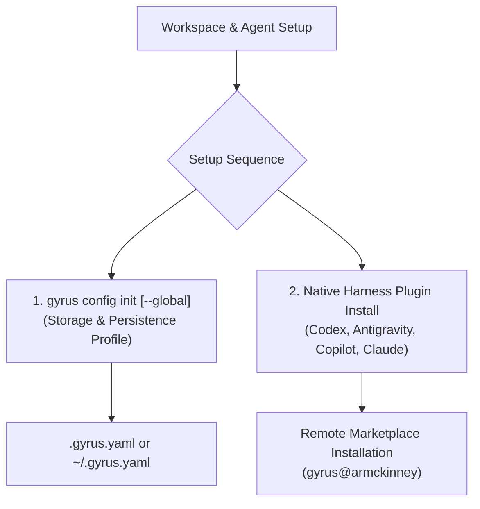

# Gyrus Installation & Initialization Guide

This guide walks you through installing the `gyrus` standalone binary, initializing your workspace configuration (`.gyrus.yaml`), and installing the Gyrus Agent Plugin into your AI coding assistant via native harness marketplaces.

---

## 📦 1. Installing the Gyrus Binary

### From Binary Release / Source Build

```bash
git clone https://github.com/armckinney/gyrus.git
cd gyrus
make build
```

Verify the installation:

```bash
./gyrus --help
```

Ensure the compiled `gyrus` executable is moved to your system `PATH` (e.g. `/usr/local/bin/gyrus`) so client harnesses can launch it for Model Context Protocol (MCP) interactions.

---

## 🚀 2. Two-Step Workspace Initialization

Gyrus cleanly decouples workspace repository configuration from client tool distribution:



---

## ⚙️ 3. Initializing Workspace & Global Configuration (`gyrus config init`)

Bootstraps repository or global configuration and sets up the local or cloud persistence profile:

```bash
# Initialize repository workspace configuration (.gyrus.yaml)
gyrus config init

# Or initialize user-wide global configuration (~/.gyrus.yaml)
gyrus config init --global
```

### Flag Options

| Flag | Shorthand | Description | Default |
| :--- | :--- | :--- | :--- |
| `--profile` | `-p` | Configuration profile (`local`, `git`, `postgres`). Unsupported values fail before writing files. | `local` |
| `--tenant` | `-t` | Default tenant for concepts. | `root` |
| `--project` | `-P` | Default project for context concepts. | `default` |
| `--global` | `-g` | Write user-wide configuration to `~/.gyrus.yaml`. | `false` |
| `--force` | `-f` | Overwrite existing configuration file without prompting. | `false` |

### Storage Profile Options (`--profile`)

```bash
gyrus config init --profile local     # LocalFS storage + OKF index/graph/search (default)
gyrus config init --profile git       # Remote Git Repository Persistence
gyrus config init --profile postgres  # PostgreSQL Database Backend
```

### Required Cloud Storage Permissions
For remote Git, configure your Git credential manager for HTTPS or SSH credentials and known hosts. See the [initiative walkthrough](guide-006-git-initiatives.md). PostgreSQL requires a connection string to your database.

---

## 🤖 4. Installing Agent Plugin via Harness Marketplace

Install Gyrus directly into your AI coding assistant using native harness plugin commands:

### OpenAI Codex CLI

```bash
# Register the GitHub repository as a remote marketplace
codex plugin marketplace add armckinney/gyrus

# Install the gyrus plugin
codex plugin add gyrus@armckinney
```

### Google Antigravity (AGY)

```bash
# Install directly from repository plugin path
agy plugin install https://github.com/armckinney/gyrus/tree/main/packaging/plugins/gyrus
```

For workspace development inside the Gyrus repository, Antigravity automatically discovers local plugins via `.agents/plugins.json`.

### GitHub Copilot CLI

```bash
# Register marketplace and install plugin
copilot plugin marketplace add armckinney/gyrus
copilot plugin install gyrus@armckinney
```

### Anthropic Claude Code

```bash
# Register marketplace and install plugin
claude plugin marketplace add armckinney/gyrus
claude plugin install gyrus@armckinney
```

---

## 5. Verify the installed configuration

Run `gyrus config show --json` and verify the resolved storage target before creating concepts. File-backed profiles use OKF keyword scanning; PostgreSQL uses native full-text search. Keyword searches default to ten results, while empty-query browsing is unlimited unless capped explicitly.

The runtime does not support an automation configuration block or hook environment switches. Configure agent behavior through the installed harness and packaged skills. Use the gyrus-test-lifecycle skill for isolated CLI, MCP, and UI verification.

## Qualified concepts and minimal links

Creation retains a local id and returns its qualified name. Address existing concepts with tenant/reference/id or tenant/projects/project/id across SDK, CLI, MCP, and UI. API envelopes include name; YAML frontmatter does not persist it. Relationships use only links with concept and rel. Dependency arrays, old link keys, per-link creation metadata, and short lookup IDs are rejected. Local IDs may repeat across tenants/projects. Incoming neighbors provide backlinks; relationship types and general cycle-safe graph traversal remain unchanged. Use the migration skill for legacy concepts or SQLite graph exports; retain backups and rebuild obsolete identity databases explicitly. Restart cached MCP processes after upgrading.

## Git commit strategies

The Git profile defaults to `commit_strategy: direct` and `trunk_branch: main`. Choose `branching` for human review and supply `--git-branch initiative/name` at runtime. Branch selection is never saved. See [standard configurations](tech-ref-002-config-schema.md) for all three stacks and both Git strategies.
