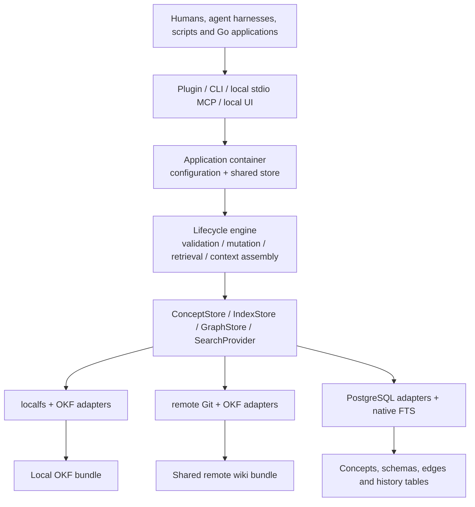

# Gyrus architecture overview and specification suite

Gyrus is an Intelligence Platform for maintaining engineering knowledge shared by humans, repositories, and agent tools. Its current foundation combines structured OKF concepts, qualified project/reference identity, typed relationships, lifecycle rules, and consistent command/protocol access. The architecture supports local knowledge, a shared Git wiki, or a shared PostgreSQL database through three complete stacks.

## System layers



The public Go contracts/types live in `pkg/gyrus`; runtime composition is in `internal/app` and `internal/provider`. The lifecycle engine is in `internal/domain/lifecycle`; format and identity validation are in `internal/format` and `internal/domain/okf`. Interface adapters call those shared behaviors rather than maintaining separate concept models.

| Stack | Storage | Index / graph | Search |
| --- | --- | --- | --- |
| local | Local filesystem | Direct OKF snapshots | OKF keyword scan |
| git | Remote Git repository | Direct OKF snapshots of the selected branch | OKF keyword scan |
| postgres | PostgreSQL | PostgreSQL | Native English PostgreSQL FTS |

The factory constructs storage from resolved configuration. The application shares the same generic store with all adapters. Git runtime branch state remains in that provider, accessed through CLI/MCP session controls. Hybrid storage/index combinations are rejected before opening resources.

## Concept and governance model

A concept is Markdown plus structured metadata, or the equivalent database payload. It has a local ID, title, type/category, tenant, version, status, update metadata, optional tags/links, and body content. Its full name derives from its scope/location:

```text
<tenant>/reference/<id>
<tenant>/projects/<project>/<id>
```

Local and Git bundles use `.gyrus/concepts/<qualified-name>.md` and `.gyrus/schemas/<type>.md`. Typed source-owned OKF links use `{concept, rel}` with `depends_on`, `implements`, `supersedes`, or `mitigates`. PostgreSQL graph edges use database tables. Incoming queries derive backlinks; graph traversal permits cycles safely.

Lifecycle transitions and finalized-body immutability make decisions maintainable without silently overwriting their history. Metadata-only updates and supersession relationships remain available. Tenant/project scope selects knowledge context; provider credentials determine storage access. Scope does not implement a separate organizational RBAC service.

## Core execution paths

**Writes:** interfaces validate input and identity, the engine applies lifecycle/mutation rules, and the store persists with provider consistency checks. Local storage uses locks/atomic replacement; Git uses confirmed remote refresh plus non-forced commits/pushes; PostgreSQL uses transactions and expected versions. Positive expected versions detect stale caller writes. Multi-source graph batches are not cross-concept transactions.

**Retrieval:** local/Git adapters scan authoritative concepts and links; PostgreSQL uses native queries. Search applies metadata/project/reference filters and limits. Context suggestion selects project matches, expands `depends_on` targets, deduplicates qualified names, and emits a bounded number of concepts in project/reference sections. It does not currently enforce token truncation or automatic authority arbitration.

**Schemas:** active-store overrides precede embedded templates. Absent overrides can fall back; storage/authentication/selection failures remain errors. Templates help authors structure knowledge, while compiled concept validation still defines accepted payloads.

**Git review:** `direct` targets `trunk_branch`; `branching` uses an initiative supplied at runtime. Concepts, schemas, links, and queries follow the same selection. Each MCP server owns its selection and waits for active requests before switching. Humans manage PR review/merging externally.

## Deployment progression and boundaries

The [source drawing](../../../../drw_arch-gyrus.png) shows four stages:

1. A local client and filesystem bundle associated with one code repository.
2. Local clients sharing a remote Git knowledge repository across projects.
3. A proposed hosted team MCP/UI using PostgreSQL-compatible Lakebase storage and native FTS.
4. A proposed enterprise control/data plane with Redis coordination, queued writes, transaction processing, analytical storage, and intelligence pipelines.

The local/Git/PostgreSQL stacks and existing local interfaces are implemented. Persistent cache providers, hosted Databricks apps, Python/gRPC integration, distributed coordination, on-behalf-of authentication, and intelligence pipelines remain roadmap work. The [architecture guide](guide-001-system-architecture.md) expands the drawing into diagrams, component boundaries, bundle topology, and open decisions. Runnable configuration belongs in the [configuration reference](tech-ref-002-config-schema.md).

## Specification navigation

| Document | Contract owned |
| --- | --- |
| [Concept schema](spec-001-contract-schema.md) | Metadata, qualified identity, links, serialization, lifecycle boundaries |
| [CLI](spec-002-cli-interface.md) | Commands, flags/defaults, output forms, error codes and runtime selection |
| [MCP](spec-003-mcp-interface.md) | Tools, parameters/results, resources/prompts and session behavior |
| [Core engine](spec-004-core-engine.md) | Provider contracts, mutation/query coordination and consistency |
| [Supported stacks](spec-005-composability.md) | Complete combinations and compatibility checks |
| [Git storage](spec-201-git-storage-driver.md) | Commit strategies, credentials, runtime branches and conflict behavior |
| [PostgreSQL storage](spec-203-postgres-storage-index-driver.md) | Database persistence and expected-version behavior |
| [PostgreSQL FTS](spec-204-postgres-fts-search-driver.md) | Search vectors, matching, filtering and limits |
| [Documentation strategy](standards-001-doc-strategy.md) | Document purposes, lifecycles, ownership and maintenance |
| [Testing strategy](standards-002-testing-strategy.md) | Test layers, Makefile commands, environment gates and verification |

The [product roadmap](prd-001-specification-roadmap.md) owns planned delivery. Historical proposals, superseded ADRs, and archived tickets preserve earlier intent; their old snippets do not override these current contracts.
