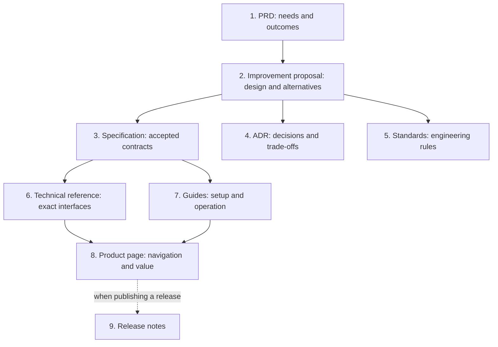
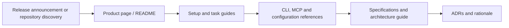

# Documentation architecture and strategy

Gyrus documentation supports two connected journeys: how a team develops and governs engineering knowledge, and how a user discovers and applies it. Documents should retain the rationale and operating detail needed for those journeys while keeping current contracts consistent with the implementation.

## Core documentation principles

1. **Treat context as an engineering asset.** Requirements, decisions, standards, and setup procedures need clear ownership, review, lifecycle, and maintenance alongside code.
2. **Update context when behavior changes.** A code change that invalidates a contract, command example, or runbook must update the affected documentation in the same change.
3. **Serve humans and agents.** Use readable Markdown plus one structured YAML frontmatter block. Qualified identity and typed relationships let tools find the same knowledge that people read.
4. **Keep each document's purpose clear.** Preserve useful explanations and examples in their owning document. Link to other documents for related subjects; avoid maintaining competing versions of the same contract.
5. **Separate current contracts from historical intent.** Preserve superseded decisions and original proposals with an explicit status. Label planned capabilities so design sketches cannot be mistaken for implemented services.

## Documentation lifecycles

### Internal development flow



- **Requirements:** A PRD states the user problem, audience, desired outcomes, constraints, and success criteria. The product roadmap tracks delivery work and its status.
- **Design:** An improvement proposal develops alternatives, architecture, risks, and acceptance criteria before the implementation is settled.
- **Blueprints:** Specifications establish current system behavior and boundaries. ADRs explain individual choices. Standards define repeatable engineering and documentation practices.
- **Implementation and use:** References record exact public interfaces; guides explain how to install, configure, operate, validate, and troubleshoot them. A product page or README introduces value and directs readers to those details.
- **Release:** Release notes describe verified changes for an actual publication milestone when needed. Routine fixes or documentation updates do not require a separate release note.

Not every change needs a new document of every type. Update the existing owner of a contract; create a proposal or ADR when there is a material design choice to record. Keep routine code edits and diffs in source control rather than duplicating them in knowledge documents.

### User discovery and consumption flow



A new user first needs to understand the value and choose an implementation. Guides then provide a complete setup or task workflow. References answer precise syntax and parameter questions. Specifications and ADRs provide the deeper contracts and rationale needed for integration or architectural changes. Each document should make the next step easy to find.

## Document types, owners, and audiences

| Type / template | Primary owner | Audience | Purpose |
| --- | --- | --- | --- |
| [prd](../../../schemas/prd.md) | Product lead | Engineering, reviewers, users | What user need is addressed, why it matters, and what success means |
| [improvement-proposal](../../../schemas/improvement-proposal.md) | Design lead | Implementers and reviewers | How a change might work, including alternatives and risks |
| [specification](../../../schemas/specification.md) | Technical owner | Implementers and integrators | Current system contracts, data rules, and boundaries |
| [adr](../../../schemas/adr.md) | Decision owner | Current/future maintainers | One architectural decision, rationale, alternatives, and consequences |
| [standards](../../../schemas/standards.md) | Engineering lead | Contributors and agents | Reusable process and quality rules |
| [technical-reference](../../../schemas/technical-reference.md) | Interface owner | Users and integrators | Exact CLI, MCP, configuration, or API details |
| [guide](../../../schemas/guide.md) | Feature/support owner | Users and operators | A complete installation, operation, or troubleshooting workflow |
| [product](../../../schemas/product.md) | Product lead | Prospective and current users | Product value and navigation to supporting documents |
| [glossary](../../../schemas/glossary.md) | Domain owner | All readers | Shared definitions and terminology |
| [release-note](../../../schemas/release-note.md) | Release owner | Users and maintainers | Verified changes and upgrade impact for a release |
| [freeform](../../../schemas/freeform.md) | Note author | Relevant collaborators | Notes that do not yet fit a more structured document |

Ownership is a documentation responsibility, not an implemented role-based authorization system. Select reference scope for shared standards/decisions and project scope for repository-specific work. The same local ID can exist in different projects; references must use complete qualified names.

## Metadata, relationships, and lifecycle

Each concept has one frontmatter block with its local `id`, title, category/type, tenant, version, status, and update metadata. The ID must match the filename. Keep it at its canonical location; derive `name`, project, and scope from that location instead of writing derived fields into frontmatter.

```text
.gyrus/concepts/<tenant>/reference/<id>.md
.gyrus/concepts/<tenant>/projects/<project>/<id>.md
```

Persist source-owned links in the minimal form:

```yaml
links:
  - concept: root/reference/spec-001-contract-schema
    rel: depends_on
```

Use `depends_on`, `implements`, `supersedes`, or `mitigates` according to the relationship's meaning. Incoming graph queries provide backlinks without storing inverse copies. OKF can retain qualified references to concepts that have not been created yet.

Living PRDs, specifications, standards, references, guides, products, and glossaries describe maintained knowledge. Historical ADRs and finalized proposals preserve why a choice was made. Follow the existing [ADR template](../../../schemas/adr.md), including Context/problem/objectives, Decision/rationale, Alternatives/pros/cons, Consequences, and Compliance & Verification.

When a decision changes, create a focused replacement ADR, link it to the old record using `supersedes`, and update the old status. Preserve historical decision content and clearly label superseded records. Metadata-only edits remain distinct from protected body changes; the engine enforces the actual [lifecycle and immutability contract](spec-001-contract-schema.md).

## Review and maintenance workflow

1. Read the relevant PRD, specifications, ADRs, and standards before changing architectural behavior.
2. Determine which documents own the affected contracts and user workflows. Preserve their useful explanations instead of replacing them with link-only summaries.
3. Update contracts and examples against the actual CLI/MCP/configuration schemas. Include failure behavior and known limitations when they affect use.
4. Check scope, metadata, version/update timestamps, relationships, and relative links. Use repository-relative links instead of machine-specific `file://` URLs.
5. Validate concepts and representative examples. Keep test results and skips explicit in the change review; do not imply a live host or capability was exercised when it was not.
6. Update the [product roadmap](prd-001-specification-roadmap.md) as work is completed or re-scoped. Archive or supersede historical records without silently turning their old examples into current instructions.

Runtime validation checks concept structure, safe identifiers, typed links, and lifecycle updates. OKF graph reads derive relationships from stored concepts; PostgreSQL maintains its graph in database tables. Documentation review additionally checks explanatory quality, completeness, and consistency—those are not guaranteed by passing schema validation alone.
