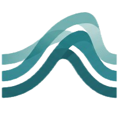
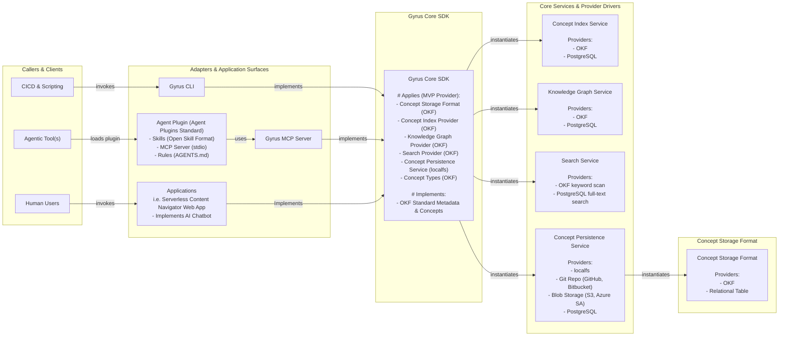

<p align="center">
  
</p>

# Gyrus: Unified Context Control Plane & Memory Engine

> **The Context Control Plane for Software Development Teams & AI Agents.**
> A shared, governed layer to discover, resolve, create, maintain, and distribute engineering context across humans, AI tools, repositories, and documentation systems.

---

## 🌟 Overview & Value Proposition

**Gyrus** is an open-source **Context Control Plane** and knowledge graph designed to bridge the gap between human engineering teams and AI coding assistants (such as Cursor, Claude Code, GitHub Copilot, and custom agents). Built in Go, Gyrus organizes codebase context, Architecture Design Records (ADRs), specifications, PRDs, runbooks, and guidelines using the **Open Knowledge Format (OKF)** standard.

Gyrus coordinates Git repositories, local filesystems, cloud object storage, PostgreSQL, lexical search, and concept relationships under a provider-neutral context model.

---

### 🌐 What Gyrus Is

* **A Shared Context Layer:** Enables developers and AI agents to work from the same trusted body of architectural, operational, and implementation knowledge.
* **A Common Interface Across Agentic Tools:** Exposes a unified API surface across CLI, stdio MCP server, Open Skill Format skills, `AGENTS.md`, and custom agent pipelines.
* **A Context Resolution Engine:** Determines what information is *applicable, current, authoritative, and required* for a specific task within token budgets, moving far beyond simple keyword search.
* **A Governed Knowledge Creation Framework:** Provides a structured promotion lifecycle (`Observation` ➔ `Candidate Memory` ➔ `Proposed Artifact` ➔ `Published Knowledge`) so AI agents propose knowledge rather than silently redefining organizational truth.
* **A Portable Artifact System:** Keeps canonical knowledge human-readable (Markdown + YAML frontmatter contracts) so context travels with code across dev containers, CI/CD pipelines, and offline environments.

---

### 🛑 What Gyrus Is Not

* **Not a replacement for Git, Confluence, or documentation platforms** — Gyrus coordinates and materializes context across them.
* **Not a coding agent or agent orchestration framework** — Gyrus provides the governed context layer that any coding or research agent consumes.
* **Portable knowledge** — Canonical Markdown concepts remain the source of truth for file-backed storage; lexical search and explicit graph relationships provide retrieval without an embedding service.
* **Not a replacement for MCP or Agent Skills** — Gyrus leverages MCP and Agent Skills as runtime transport and behavioral integration adapters.

---

## 🎯 Core Engineering Pillars

1. 📄 **Concept Data Contracts (OKF):** Validates structured software contracts (`adr`, `prd`, `specification`, `guide`, `standards`, `glossary`, `improvement-proposal`, `release-note`) rather than unstructured text dumps.
2. 🕸️ **Knowledge Graph & Edge Indexing:** Traverses explicit directional links (`depends_on`, `supersedes`, `implements`, `mitigates`) for deep architectural context.
3. 🧩 **Composable Service Providers:** Runs locally (`localfs` + direct-scan OKF providers) or scales to enterprise cloud backends (Git repos, AWS S3, Azure SA, PostgreSQL).
4. 🌐 **Unified Memory Persistence:** Operates as a single source of truth across CLI tools (`gyrus`), MCP stdio servers, agent skills, and web dashboards.
5. 📦 **Composable Core SDK (`pkg/gyrus`):** Embeds a zero-dependency Go engine directly into custom AI pipelines, CLI tools, and background workers.
6. 🎯 **Token-Budgeted Context Resolution (`gyrus suggest-context`):** Synthesizes high-signal, non-redundant context within prompt token limits.
7. 🔄 **State Machine & Immutability Governance:** Enforces validated document lifecycle state transitions (e.g. `proposed` ➔ `accepted`) and runtime content immutability for decision logs (`immutable: true`).
8. 🚀 **Embedded Templates (`go:embed`) & Custom Overrides:** Ships 11 pre-packaged Markdown schema templates with `.gyrus.yaml` override support.

---

## 📊 Market & Solution Comparison

| Solution Category | Strengths | Gaps | 🌌 **Gyrus Context Control Plane Value** |
| :--- | :--- | :--- | :--- |
| **Agent Skills** *(e.g. `.cursorrules`, `SKILL.md`)* | Portable instructions & zero-latency local prompt hints | Cannot provide shared state, authority, lifecycle, or multi-agent enforcement | Adds durable context persistence, schema validation, task resolution, and state machine governance |
| **Documentation Platforms & MCPs** *(e.g. Confluence)* | Human-readable pages, search, permissions, & rich wiki collaboration | Provider-specific, page-centric, lacks repository scoping & engineering contract schemas | Adds a provider-independent artifact model, contract validation, and task-specific context resolution |
| **Skills + Documentation MCP** | Low-cost way to guide agents toward structured docs | Relies on each agent to consistently follow instructions; high prompt token bloat | Converts recommended agent behavior into an enforceable Go core engine & single-source MCP |
| **Agent Memory Platforms** *(e.g. Mem0)* | Persistent facts, session memories, and user state | Optimized for individual agents rather than shared, governed, human-readable knowledge | Preserves coherent Markdown artifacts and separates temporary memory from trusted knowledge |
| **Repository-Local Files** | Version-controlled, portable, close to the code | Limited global discovery, cross-repository reuse, & central governance | Combines local repository ownership with global context inheritance and unified indexing |
| **Vector DBs & RAG Frameworks** *(e.g. Pinecone, Chroma)* | High-dimensional semantic similarity search | Raw text chunks lack contract boundaries, explicit edges (`depends_on`), or state governance | Provides governed concepts, lexical search, and explicit relationships; semantic search is deferred to future backend work |
| **Gyrus Context Engine** | **Shared, governed, portable context across humans & heterogeneous AI agents** | *Complements existing tools rather than replacing them* | **Provides canonical OKF contracts, context resolution, provider neutrality, & zero-infra local/cloud scale** |

> 📖 *For a complete strategic comparison and deep-dive market analysis, see the official PRD: [Gyrus Product Value Proposition & Strategic Positioning](.gyrus/concepts/root/reference/prd-002-value-proposition-positioning.md).*

---

## 🏛️ High-Level System Architecture



---

## 🚀 Getting Started

### 1. Installation

Install the pre-compiled `gyrus` binary automatically across Linux, macOS, and Windows (Git Bash/WSL):

```bash
curl -sSL https://raw.githubusercontent.com/armckinney/gyrus/main/packaging/install.sh | bash
```

*Alternatively, build from source using Go 1.25+:*

```bash
git clone https://github.com/armckinney/gyrus.git
cd gyrus
make build
```

This compiles the standalone `gyrus` executable into the workspace root.

### 2. Initialize Workspace

Gyrus decouples workspace repository configuration from client tool distribution using explicit initialization subcommands:

#### Step 2a: Initialize Workspace or Global Configuration
```bash
# Initialize workspace configuration (.gyrus.yaml in current repository)
gyrus config init

# Or initialize global user-wide defaults (~/.gyrus.yaml across all repositories)
gyrus config init --global

# Inspect the resolved configuration at any time
gyrus config show
```
Generates `.gyrus.yaml` in the workspace root (or `~/.gyrus.yaml` when using `--global`) with your desired profile (`local`, `git`, `blob`, `s3`, `azure`, `gcs`, or `postgres`) and tenant boundary (`tenant`). Use `--force` to overwrite an existing configuration. Unsupported profiles fail before writing files.

File-backed profiles default to direct-scan OKF indexing, graph relationships, and search with no database. Keyword searches return the top 10 matches; empty-query browsing returns all metadata matches. PostgreSQL provides native full-text search. Vector search, its profile, and embedding configuration have been removed; legacy vector settings fail explicitly.

```yaml
tenant: root
project: my-project
storage:
  provider: localfs
  root: .gyrus
index:
  provider: okf
graph:
  provider: okf
search:
  provider: okf
```

Explicit links persist as `links: [{concept, rel}]` in source frontmatter. Targets use qualified names such as `root/reference/adr-example` or `root/projects/gyrus/ticket-003`; dependency arrays and per-link creation metadata are removed. Existing-concept operations require qualified names, while creation keeps a local frontmatter `id`. API results expose the derived `name`. Before switching an existing SQLite graph, use the packaged [gyrus-migrate-sqlite-to-okf skill](packaging/plugins/gyrus/skills/gyrus-migrate-sqlite-to-okf/SKILL.md) to back up and export database-only edges.

SQLite index/graph/search providers and the CLI/MCP sync operation have been removed. OKF reads concepts and links directly from storage. The shared SQLite persistence package remains available for future cache work. Semantic search and vectorization are deferred to future backend work.

Keyword search defaults to ten results. CLI `--max-results` and MCP `max_results` pass positive limits through to the selected provider; empty-query metadata browsing is unlimited unless a positive limit is supplied. PostgreSQL search applies the same tenant, scope, and project filters.

The UI graph expands outgoing links only from concepts visible in its active scope. Immediate external targets appear as display-only ghost nodes, with deterministic node/edge ordering. Edge-query failures return an error instead of a partial graph. PostgreSQL stale updates use the shared concurrency error and CLI exit code 4.

#### Step 2b: Install Agent Plugin via Client Marketplace

Install Gyrus directly into your AI coding assistant using native harness plugin commands:

```bash
# OpenAI Codex CLI
codex plugin marketplace add armckinney/gyrus
codex plugin add gyrus@armckinney

# Google Antigravity (AGY)
agy plugin install https://github.com/armckinney/gyrus/tree/main/packaging/plugins/gyrus

# GitHub Copilot CLI
copilot plugin marketplace add armckinney/gyrus
copilot plugin install gyrus@armckinney

# Claude Code
claude plugin marketplace add armckinney/gyrus
claude plugin install gyrus@armckinney
```

The Gyrus Agent Plugin package (compliant with the [Agent Plugins Standard 1.0.0](https://agent-plugins.org/)) equips your coding harness with Gyrus context resolution skills (`skills/gyrus/SKILL.md`), governance instructions (`rules/AGENTS.md`), and pre-configured stdio Model Context Protocol (MCP) server integration.

> 📖 **Full Guide:** For advanced customization and enterprise storage profiles, see the **[Gyrus Installation & Initialization Guide](.gyrus/concepts/root/reference/guide-005-installation-and-initialization.md)**.

Once initialized, AI agents have immediate access to Gyrus CLI commands and OKF frontmatter schema references.

Use the packaged [gyrus-test-lifecycle skill](packaging/plugins/gyrus/skills/gyrus-test-lifecycle/SKILL.md) for agent-led verification of an installed release through CLI, MCP, and HTTP interfaces. It uses temporary localfs/OKF data and public Gyrus commands, without repository source, builds, development tests, or a bundled scripting runtime. The [gyrus-migrate-sqlite-to-okf skill](packaging/plugins/gyrus/skills/gyrus-migrate-sqlite-to-okf/SKILL.md) guides legacy relationship and SQLite graph migration without a Go installation.

By default, Gyrus resolves configuration and storage path in the following order:
1. **Workspace Config:** `.gyrus.yaml` located in current working directory or any parent repository directory.
2. **Global User Config:** `~/.gyrus.yaml` in the user's home directory.
3. **Hardcoded Defaults:** LocalFS storage driver rooted at `~/.gyrus/`.

### 3. Create your first OKF Document

Create an Architecture Design Record (ADR):

```bash
./gyrus create \
  --id "adr-001-storage-engine" \
  --title "Use OKF for portable knowledge" \
  --category "architecture" \
  --type "adr" \
  --tenant "root" \
  --scope "reference" \
  --content "We choose direct-scan OKF for portable knowledge and keyword search."
```

### 4. Search and Suggest Context

Search across your contract documents:

```bash
./gyrus search --query "OKF search"
```

Suggest linearized context matching an agent prompt:

```bash
./gyrus suggest-context --prompt "How is local search implemented in Gyrus?"
```

---

## 📚 Documentation Sitemap

- 🏛️ **[System Architecture](.gyrus/concepts/root/reference/guide-001-system-architecture.md):** Complete guide to the Gyrus Core SDK, Provider Framework, OKF directory topology, and state machines.
- 🧪 **[Testing Strategy & QA Standards](.gyrus/concepts/root/reference/standards-002-testing-strategy.md):** Complete guide to test tiers, CI/CD integration, benchmark standards, environment toggles, and live cloud infrastructure testing.
- ⚙️ **[Configuration Reference](.gyrus/concepts/root/reference/tech-ref-002-config-schema.md):** Comprehensive reference for all `.gyrus.yaml` options, profiles, and path precedence.
- 🛠️ **[CLI Reference Manual](.gyrus/concepts/root/reference/tech-ref-001-cli-manual.md):** Detailed argument and flag reference for all 11 `gyrus` CLI subcommands and exit codes.
- 🔌 **[MCP Reference](.gyrus/concepts/root/reference/tech-ref-003-mcp-manual.md):** Tool parameters, provider-aware retrieval, resources, and stdio server setup.
- 🤖 **[Agent Plugins & Skills Setup Guide](.gyrus/concepts/root/reference/guide-003-agent-skills-setup.md):** Instructions for installing the Gyrus Agent Plugin and equipping skills for Antigravity, Copilot, Codex, and Claude.
- 📜 **[ADR-005: Global Configuration & Precedence Hierarchy](.gyrus/concepts/root/reference/adr-005-global-configuration-and-precedence-hierarchy.md):** Architecture Decision Record establishing dedicated `internal/config`, canonical nested YAML schema, and file-driven 3-tier precedence.
- 📜 **[ADR-004: Agent Plugin Packaging, Distribution & Init Revamp](.gyrus/concepts/root/reference/adr-004-agent-plugin-packaging-distribution-and-init-revamp.md):** Architecture Decision Record formalizing the Agent Plugins Standard 1.0.0, canonical embedded plugins, and explicit init subcommands.
- 📑 **[Value Proposition & Strategic Positioning PRD](.gyrus/concepts/root/reference/prd-002-value-proposition-positioning.md):** Comprehensive market-wide strategic comparison PRD of Gyrus vs enterprise context engines, vector DBs, memory platforms, and agent skills.
- 📋 **[Specification Implementation Roadmap](.gyrus/concepts/root/reference/prd-001-specification-roadmap.md):** Master roadmap across Phase 1 MVP, Phase 2 Version 1.0, and Phase 3 Future Extensions.


## License
**Gyrus** is licensed under the **MIT License with the Commons Clause v1.0 Condition**. 
You are free to use, modify, and distribute this software, provided you do not sell it or offer it as a paid/hosted service. See the [LICENSE](LICENSE) file for details.
